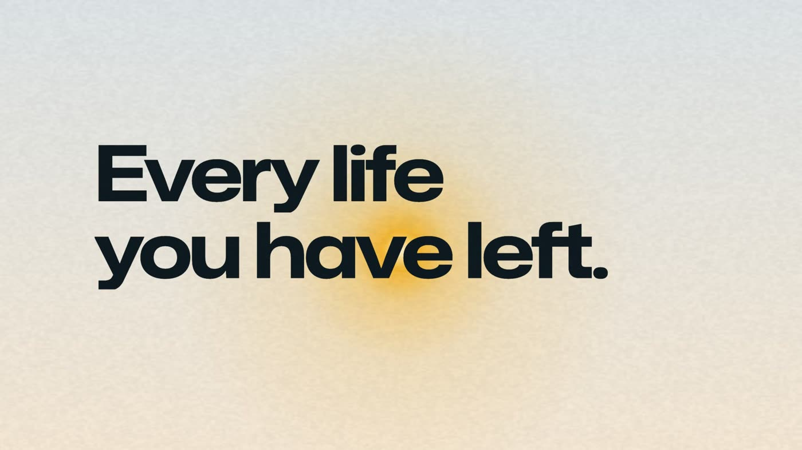
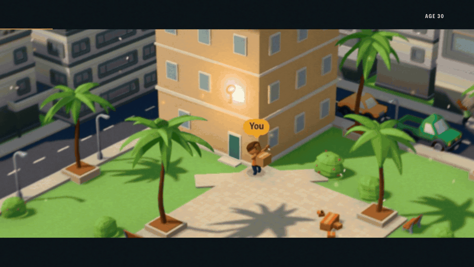
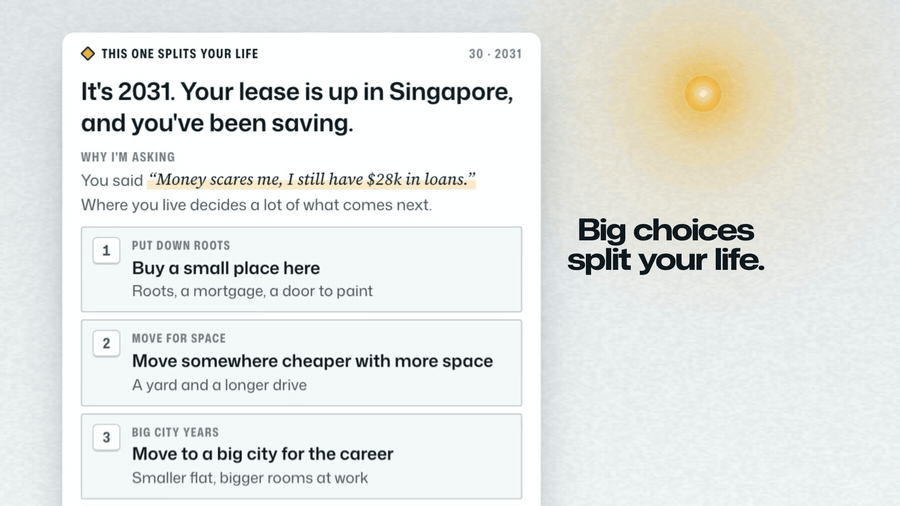
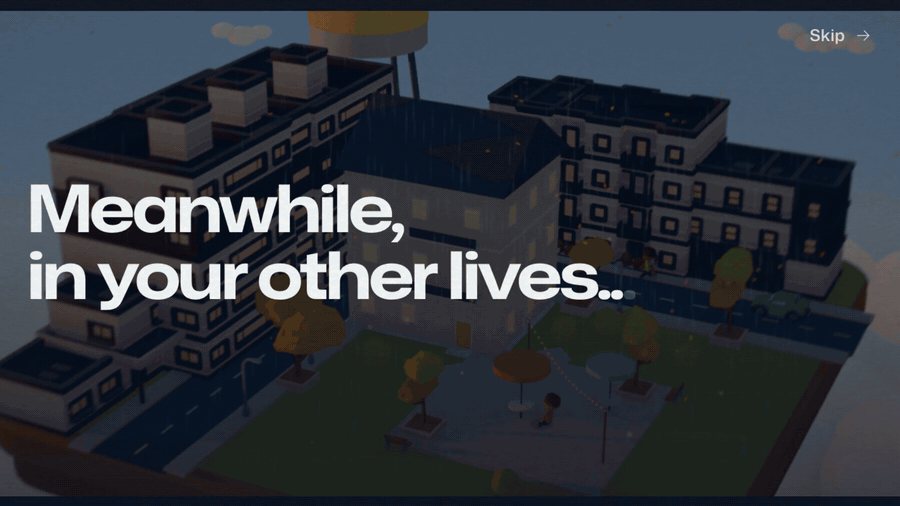
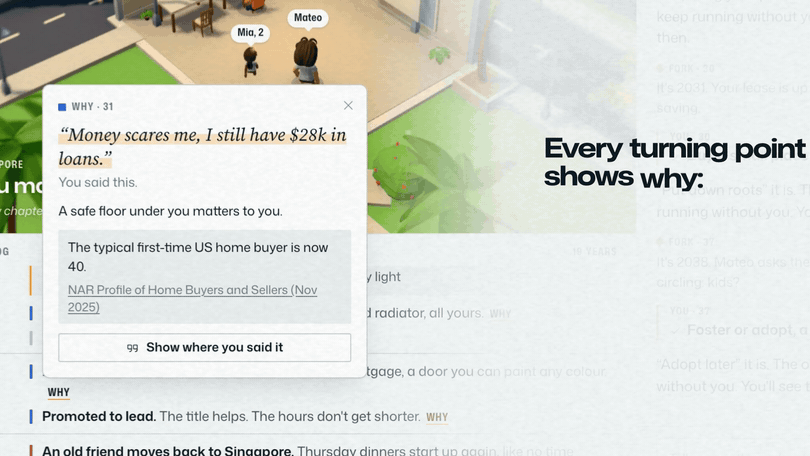
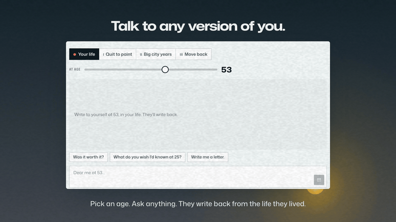
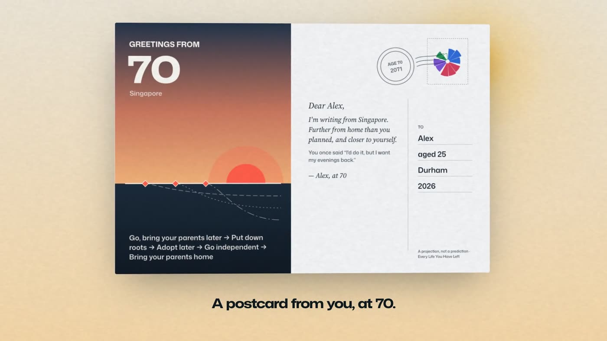

<div align="center">



# Every Life You Have Left

### Live the rest of your life before you choose.

Tell it who you are. It lives your life forward, one year at a time, to 70.
Every big choice splits it, and **the answers you didn't pick keep running** as lives of their own.

**[▶ Play it now](https://every-life-you-have-left.supawich.workers.dev)** · [Watch the video (3:29)](https://youtu.be/VKNkcKYHers) · [How it works](#how-it-works)

*Built in one weekend at the Triangle AI Hackathon, Duke University, November 2026. Track: Social Impact & Education.*

</div>

---

## You have about 45 summers left. Want to see a few ways to spend them?

If you're 25, you get roughly 45 more summers before 70. Most of them will be decided by a handful
of choices you'll make in the next few years: the city, the job, the person, the house, the leap.

You only get to live one of them. **Every Life You Have Left** lets you live several of them first.



## What happens when you play

**1. Tell it who you are.** Your age, your city, one line about what's been on your mind. Type it or
hold to talk. Add a CV, a LinkedIn PDF or an export from your AI app if you want it to know you faster.
A short warm-up (up to five questions) fills in the rest.

**2. Your life starts playing.** A little 3D world shows the year you're in: your home, your street,
the people in it. A life log writes itself underneath. Your illustrated portrait ages with you.

**3. Small choices come along the way.** Do you take the weekend job? Call your sister back? Each one
teaches it a little more about you. Answer with a tap, or say more in your own words.

**4. Big choices split your life.** When a real crossroads comes, time stops.



You pick one. The other three don't disappear: they keep living in the background, and every so
often you get a glimpse: *"Meanwhile, in your other lives…"*



**5. Ask why.** Every turning point shows its working: **the exact sentence you said** that pushed it
this way, and **a real statistic** about how often it goes this way for people like you.



**6. Arrive at 70.** You see every life you have left, side by side, each with its own city, its
own people, its own money, its own one-line verdict. None of them is ranked best.


Then:
- **A postcard from you at 70**, with a QR code to share it.
- **"Where do you see yourself in five years?"**, answered by each version of you, read aloud.
- **Talk to any version of you**, at any age. Ask the 70-year-old who moved to New York if it was worth it.





## Why it's not a horoscope

- **Your words, cited.** Every turning point links back to something you actually said.
- **Real base rates.** The lives are held to 35 sourced statistics: how often people change jobs at
  each age, move, buy a first home, marry, have children, get laid off. Sources include BLS, the US
  Census Bureau, Pew, NAR, Gallup and the Harvard Study of Adult Development.
- **Realism guards in code.** Money moves smoothly unless something explains a jump. Children only
  arrive through a door you opened. Friends drift with distance. Rare shocks are rolled in code at real
  odds and never repeat. A validator rejects invented catastrophes.
- **Kind by design.** No death or serious illness for you, and never for your partner or child. No
  race, ever. If something you type suggests you're struggling, it shows crisis resources (988 in the US).
- **A projection, not a prediction.** It says so on every money figure.

## Why this matters

Your future self feels like a stranger, and people don't save, plan or take risks for strangers.
Making that future self vivid changes behaviour:

- People who feel more connected to their future self have **saved more** (Ersner-Hershfield et al., 2009).
- Seeing an aged version of yourself raised **retirement saving** in experiments (Hershfield et al., 2011).
- In MIT's *Future You* study, **344 young adults** had one conversation with an AI future self, and it
  **reduced their anxiety** and **strengthened their connection to their future self** (Pataranutaporn et al., 2024).
- Seeing **several** possible future selves, not one, **widened people's sense of what's possible**
  (*Possible You*, NeurIPS 2025).

Every Life You Have Left gives you several futures at once, built from your own words, on real
numbers. We built it for the people at their first big crossroads: students and new grads deciding
what comes after graduation, who mostly decide alone.

## Time flies (on purpose)

The years right after today play slowly and are full of choices. Later ones go faster with fewer
choices, and a new chapter in your life (a move, a new job, a partner, a child) slows time down
again. That's how a life feels from the inside: William James noticed in 1890 that new years feel
long and routine years shrink.

| Speed | Big choices | Small choices | Takes |
|---|---|---|---|
| **Auto** | 5 | none | about 3 minutes (start here) |
| **4×** | ~5 | ~15 | quick |
| **2×** | ~10 | ~30 | considered |
| **1×** | ~18 | ~100 | deep: a real conversation with your life |

## Your data

You choose before you start, in three separate boxes: **18+** (required), **save my life for 30 days**
(optional; off means **incognito**: nothing is written to our database and the session erases itself
after 24 hours), and **let the team read it to improve the app** (optional).

- Saved lives are deleted automatically after 30 days. Uploads and selfies are deleted after 7 days
  and **encrypted with AES-256-GCM** before they're stored.
- **Delete my data** is one button, in the game, on the ending screen and at `/privacy`.
- No accounts, no email, no ads, no tracking. Nobody trains an AI model on your life.
- The full privacy notice is written in plain English, long on purpose: [`/privacy`](https://every-life-you-have-left.supawich.workers.dev/privacy).

## The films and the music

**[Watch the trailer and the tutorial on YouTube](https://youtu.be/VKNkcKYHers)** (3:29). The
GIFs on this page come from that trailer. Every frame is the real app, filmed frame by frame
from the built-in demo life of a made-up person called Alex (`/?demo=alex`).

**The game has its own score**: 11 original cues that follow your life. A quiet piano plays during
the warm-up, and each stretch of life has its own bed (hopeful at 25–34, momentum at 35–49,
reflective at 50–59, tender at 60–70). A big decision gets its own suspense, the split gets a
stinger, and *"Meanwhile…"* gets a dreamy canon. Hard and bright years have their own colours, and
the ending gets the main theme. The cues loop seamlessly with Web Audio, cross-fade between parts,
and duck under the future-you voice and while you hold to talk. One button turns them off, and it
remembers your choice.

The trailer's music is in [`media/music/`](media/music/):

| Track | Length | |
|---|---|---|
| [`every-life-promo-theme.mp3`](media/music/every-life-promo-theme.mp3) | 1:24 | The trailer's score. A solo piano theme that splits into three voices at the fork and blooms into strings at 70. |
| [`every-life-tutorial.mp3`](media/music/every-life-tutorial.mp3) | 2:06 | A calm bed on the same theme, with a chime for each chapter. |
| [`every-life-social.mp3`](media/music/every-life-social.mp3) | 0:42 | The vertical cut's score. |

All of it was written note by note in code and played on sampled instruments (no audio-generation
model). The in-game cues are in [`public/music/`](public/music/).

## How it works

<table>
<tr><td><b>One Worker</b></td><td>Cloudflare Workers serves the React app and a Hono API from one deployment.</td></tr>
<tr><td><b>One live session per life</b></td><td>A Durable Object (Cloudflare Agents SDK) runs each life: it plans the years, writes ahead, holds the hidden branches and streams patches to the browser over a WebSocket.</td></tr>
<tr><td><b>The writers</b></td><td>Gemini on Google Cloud: Flash for the years and the forks, Flash-Lite for small cards and branches, an image model for the portraits, a speech model for future-you's voice, Google Search grounding to check the places and employers you name.</td></tr>
<tr><td><b>The truth</b></td><td>A ledger of people, places, work and money that every generated year is checked against. Pacing, life shocks, children, money continuity and name choice are all owned by code, not left to the model.</td></tr>
<tr><td><b>The world</b></td><td>React Three Fiber renders a per-year diorama from a scene spec, with CC0 models by Kenney and Quaternius. Pedestrians path-find around your house (and a test walks 17,000 of them to prove it).</td></tr>
<tr><td><b>Storage</b></td><td>D1 for saved lives, R2 for files, a daily cron for retention, app-level encryption for uploads.</td></tr>
<tr><td><b>Cost guards</b></td><td>A spend ledger with an app-wide cap and per-session caps. A three-minute Auto life costs about $0.55 in model calls.</td></tr>
</table>

Front end: React 19, TypeScript, Vite, React Three Fiber, GSAP, Radix, Zustand.

### Run it yourself

```bash
npm install
npm run db:migrate:local
npm run dev
```

Open `http://localhost:5173/?demo=alex` to play the offline demo life without any API key. For real
lives, add a `.dev.vars` file with `GCP_API_KEY` (a Google Cloud key with Vertex AI / Agent Platform
access), `ADMIN_PASSCODE` and `DATA_KEY` (32 random bytes, base64: `openssl rand -base64 32`).

Checks: `npm run typecheck`, `npm run check:qa` (life-consistency and pacing regressions),
`npm run check:world` (nobody walks through a wall).

## Team

**Supawich Puengdang** and **Paul**, with a lot of help from Claude Code agents. Everything here was
built during the event.

### Credits

- **3D models:** [Kenney](https://kenney.nl) and [Quaternius](https://quaternius.com) (CC0). Full
  credits in [`ASSETS.md`](ASSETS.md).
- **Music:** composed for this project and rendered with FluidSynth and FFmpeg. Instrument samples:
  - VSCO 2 Community Edition and the Versilian Community Sample Library (VCSL) by Versilian Studios (CC0).
  - Osiris Piano by Karoryfer Samples (CC0).
  - Karoryfer x bigcat cello by Karoryfer Lecolds and bigcat instruments (CC0).
  - The in-game cues use only the CC0 instruments above.
  - Contrabass (trailer and vertical cut) from the MuseScore MS Basic SoundFont (MIT): FluidR3 by
    Frank Wen © 2000–02, FluidR3Mono by Michael Cowgill © 2014–17, adaptation by S. Christian Collins © 2018–19.
- **Icons:** [Phosphor](https://phosphoricons.com) (MIT) in the app; [Lucide](https://lucide.dev) (ISC) in the trailer.
- **Type:** Mona Sans and Source Serif 4 (SIL Open Font License).

<div align="center">

---

**None of them is the right one. All of them are yours.**

[every-life-you-have-left.supawich.workers.dev](https://every-life-you-have-left.supawich.workers.dev)

</div>
